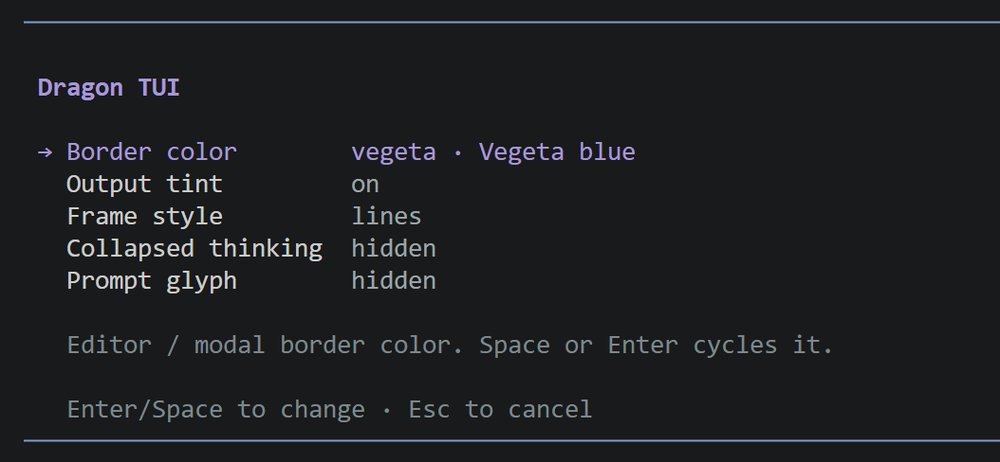

# pi-dragon-tui

**English** | [简体中文](README.zh-CN.md)

Dragon Ball / Namek-flavored pi extension: framed editor and dialogs, theme-tinted markdown output, Namekian working words, tok/s, and switchable accent palettes.


## Install

```bash
pi install npm:pi-dragon-tui
# or
pi install git:github.com/oahcz-7891/pi-dragon-tui
```

## Features

- **Editor frame** — `rounded` box or `lines` (pi-native rules), with a border-colored prompt glyph (`>` / `_` / hidden). Wrapped lines keep the indent. The frame ignores theme, thinking-level and bash-mode color overrides.
- **Framed dialogs** — every `ctx.ui.custom()` modal gets the same frame; built-in `select` / `confirm` / `input` / `editor` stay native.
- **Output tint** — markdown headings, links, inline code, code blocks, quotes, list bullets and body text lean toward the active palette. Code-block syntax highlighting stays native. Toggle in `/dragon`; on by default.
- **Palettes** — Goku gold `#f0c674`, Vegeta blue `#7d9ed4`, Piccolo green `#7fc95a`. Switch live from `/dragon`; frame, spinner, TPS, prompt glyph and output tint share one color source. Saved across restarts.
- **Collapsed thinking** — while reasoning is hidden, show `1 line`, `2 lines`, or nothing under pi's `Thinking...` header. Expanded thinking is untouched.
- **Namekian working words** — "Working" rotates through `Purunga…` and friends, per turn or on a timer.
- **TPS** — live `48.2 tok/s` while streaming, then the session average, in the border color. Tool waits and TTFT are excluded.

## Command

```
/dragon    # settings menu: border color, output tint, frame style, collapsed thinking, prompt glyph
```

`↑↓` move, `Space` / `Enter` change in place, `Esc` closes. There are no subcommands — any arguments are ignored and the menu opens.

Choices are saved to `<agent dir>/.dragon-tui.json` (`~/.pi/agent/`, overridable via `$PI_CODING_AGENT_DIR` or `$PI_DRAGON_TUI_CONFIG`) and survive restarts.



## Config

Constants at the top of `index.ts`:

- **Prompt** — `BORDER_HEX`, `PROMPT_LEAD`, `PROMPT_GLYPH_DEFAULT`, `FRAME_STYLE_DEFAULT`, `ROUNDED_ENABLED`.
- **Output tint** — `OUTPUT_TINT_DEFAULT`; weights and body mix live in `tint.ts`.
- **TPS** — `TPS_ENABLED`, `TPS_PREFIX`, `TPS_SUFFIX`, `TPS_REFRESH_MS`.
- **Thinking / spinner** — `THINKING_MODE_DEFAULT`, `THINKING_HINT`, `WORKING_WORDS`, `WORKING_ROTATE_MS`.
